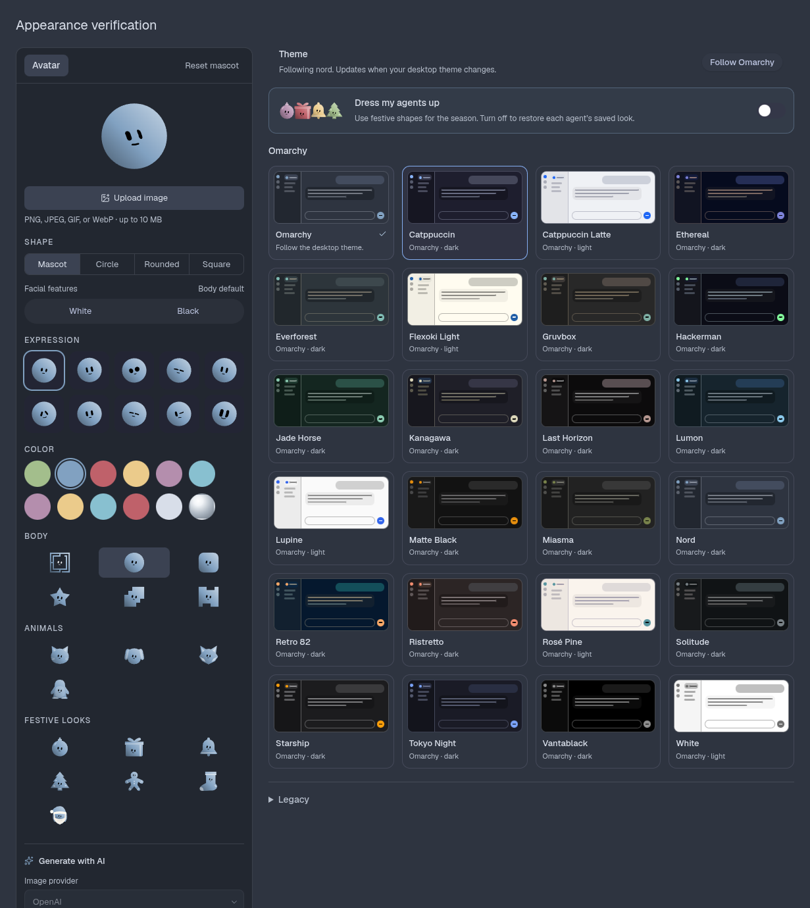

# Omagent for Omarchy

A local-first desktop workspace for teams of AI agents, built for Omarchy.

**Experimental preview · Arch Linux / Omarchy · x86_64**



*Appearance shown in a disposable test workspace.*

Chat with agents, give them a browser, schedule routines, and connect your own
model providers. Omagent follows your Omarchy theme automatically and includes
custom animated mascots. Pair Telegram to talk to your agent from your phone.

## Install

Download the Arch package or AppImage from
[GitHub Releases](https://github.com/benryanx/omagent-omarchy/releases).
Preview releases are listed explicitly; they may not appear under “Latest”.

For the Arch package, open a terminal in the download folder:

```sh
sudo pacman -U ./omagent-*.pkg.tar.zst
```

Then launch **Omagent** from the app launcher. The package installs the `omagent`
command and desktop entry. It does not require Node.js or pnpm at runtime.

For the AppImage, make the downloaded `.AppImage` executable and open it. It
runs without installing the Arch package. Use one distribution at a time.
Compare the download's SHA-256 hash with the release's `SHA256SUMS` file.

Omagent is an independent project. Inclusion in Omarchy's package repository is
not implied by this preview. Updates are downloaded manually from this repository;
automatic updates and hosted subscriptions are disabled.

## First run

1. Open Omagent and create your agent.
2. Connect your own model provider or an installed provider CLI. Existing CLI
   sign-ins on your computer may be available to you; none are shipped by Omagent.
3. Choose the agent's permissions and enable its browser when needed.
4. Optionally connect Telegram in **Settings → Messaging & payments**, create
   a pairing link, and open it from your private Telegram account.

Your chats, credentials and browser profiles stay in your local application
workspace. Other users start with their own workspace. Omagent must remain
running for Telegram messages and local routines to work.

Agentcard checkout is optional and experimental. Configure your own project
credentials and card enrollment; payment authorization still uses Agentcard's
approval flow. The app has no included model credits, cloud hosting or payment
account. Provider and integration charges belong to the accounts you connect.

The browser works independently of direct desktop control. Direct control of
the host desktop is unavailable on Omarchy's Wayland session in this preview.
Do not rely on unattended purchasing or recovery of an interrupted checkout.

## Build from source

Requires Node.js 24+, pnpm 10.33.0, and Linux x86_64. Install Arch's build tools
for package creation. Packaging downloads pinned third-party browser/runtime
binaries and verifies their checksums.

```sh
git clone https://github.com/benryanx/omagent-omarchy.git
cd omagent-omarchy
pnpm install --frozen-lockfile
pnpm dev:install
pnpm dev:app
```

**Omagent Dev** uses a separate workspace under `~/.local/share/omagent-dev`.
The application and development workspace are independent. No profile import
is required or performed by the release.

```sh
pnpm typecheck
pnpm lint
pnpm check:privacy
pnpm check:branding
pnpm package:omarchy
```

See [Omarchy integration](OMARCHY.md), [release procedure](docs/releasing.md),
[verification](docs/verification/README.md), and [security reporting](SECURITY.md).

## License and origin

[Apache License 2.0](LICENSE). Original upstream copyright and attribution are
retained in [NOTICE](NOTICE); bundled components retain their notices in
[third_party](third_party/). This repository starts with a clean source snapshot
of the Omarchy adaptation rather than importing the development repository's
history or personal workspace.
